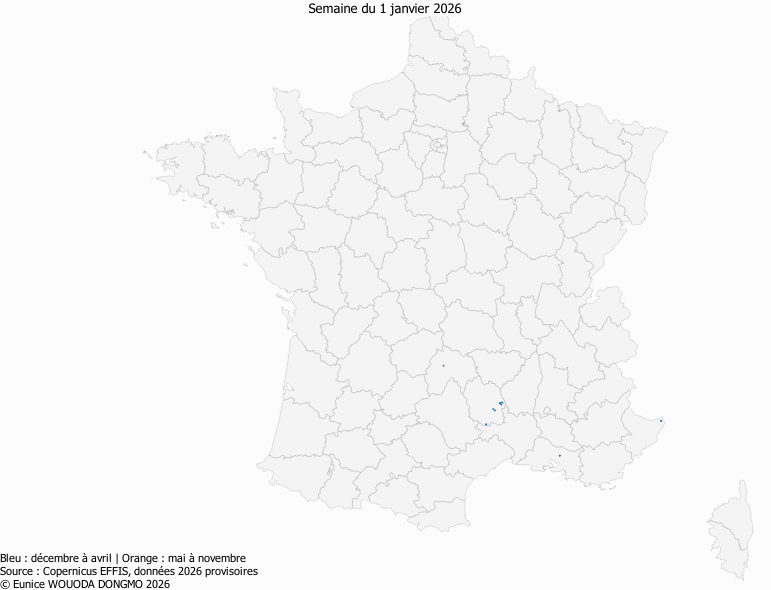
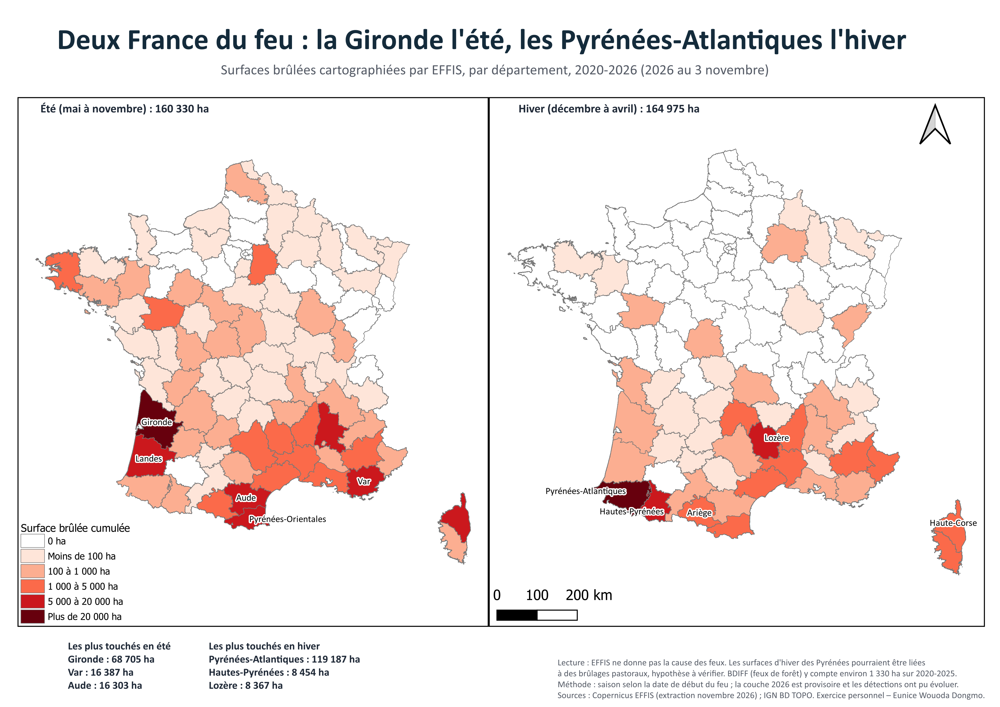

# Feux en France : animation 2026 et carte par saison

Exercice personnel de géomatique réalisé dans QGIS à partir des données Copernicus EFFIS.

## Animation 2026, semaine par semaine

Bleu : décembre à avril. Orange : mai à novembre.

- **Surface cartographiée au 3 novembre 2026 :** 108 938 ha
- **Départements les plus touchés :** Gironde (37 629 ha) et Pyrénées-Atlantiques (28 097 ha)

## Deux France du feu, 2020-2026

Sur 2020-2026, les surfaces cartographiées sont proches entre l'été (160 330 ha)
et l'hiver (164 975 ha), mais pas au même endroit :
la Gironde domine en été et les Pyrénées-Atlantiques en hiver.

## Méthode
1. Extraction des polygones EFFIS français.
2. Classement des feux par saison selon leur date de début.
3. Animation hebdomadaire avec le Contrôleur temporel de QGIS.
4. Export des images, puis assemblage en GIF avec un script Python préparé avec l'aide d'une IA.

## Limites
- Les données 2026 sont provisoires.
- Chaque polygone apparaît entier à sa date de début : l'animation ne montre pas
  la progression réelle des feux.
- Les contours sont épaissis pour la lisibilité.
- EFFIS ne donne pas la cause des feux. Le lien entre les surfaces d'hiver
  des Pyrénées et des brûlages pastoraux reste une hypothèse à vérifier.

## Prochaine étape
Les animations 2020-2025 sont en préparation.

## Sources
Copernicus EFFIS, extraction de novembre 2026 ; IGN BD TOPO pour le fond départemental.

Eunice Wouoda Dongmo, géomaticienne
